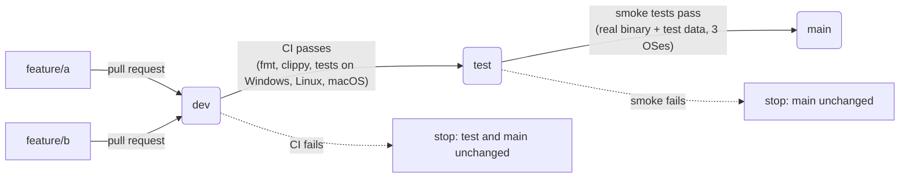

# Branch flow: feature → dev → test → main

Every change travels the same road, and `main` only ever holds code that passed
every stage:



| Branch | Who writes to it | What runs there | Moves on to |
|--------|------------------|-----------------|-------------|
| `feature/<name>` | you, one feature per branch | CI on every push and on the pull request (`ci.yml`) | `dev`, by merging the pull request |
| `dev` | pull requests only | CI again, on the merged result (`pipeline.yml`, job `dev-ci`) | `test`, automatically |
| `test` | the pipeline only | end-to-end smoke tests with test data (`smoke.yml`, called by `pipeline.yml`) | `main`, automatically |
| `main` | the pipeline only | — (release tags `v*` are cut from here, `release.yml`) | — |

Promotions (`scripts/promote.sh`) leave `test` and `main` holding **exactly the
tested content**, and never force-push:

- usually `test`/`main` are simply fast-forwarded to the tested commit;
- if the branch already has that content (e.g. you merged a `dev → test` pull
  request by hand), there is nothing to do;
- if the branch only has extra merge commits that add nothing (left by such
  hand-merged pull requests), a merge commit with the tested content is added
  on top.

If `main` or `test` has changes that `dev` does not (someone committed there
directly), the promotion stops with an error instead of overwriting them; merge
that branch into `dev` and the flow continues. Promoting by hand with pull
requests is fine, but not needed: the pipeline does it.

## Working on a feature

```bash
git switch -c feature/status origin/dev     # one branch per feature
# ... commits ...
git push -u origin feature/status
# open a pull request into dev; CI must be green before merging
```

After the merge nothing else is manual: the `Pipeline` workflow runs CI on `dev`,
fast-forwards `test`, runs the smoke tests, and fast-forwards `main`. Follow it
under **Actions → Pipeline**. A failure stops the flow at that stage; fix it with
a new pull request into `dev`.

## The test stage and its test data

`tests/smoke/run.sh` starts the release binary in front of a stand-in app and
checks what a visitor would see. The test data lives next to it:

| File | Role |
|------|------|
| `tests/smoke/smoke.toml` | hostip config: an open port 9443 and a password-protected port 9444 (`demo` / `secret`) in front of local port 3999, fixed public IP `203.0.113.7` (a documentation address), no router or Let's Encrypt access |
| `tests/smoke/app.py` | the stand-in app on port 3999, serving `data/` with `Range` support |
| `tests/smoke/data/hello.txt` | the file fetched through hostip |

Checks: the file arrives unchanged over HTTPS; a `Range` request comes back as
`206 Partial Content`; HTTP/2 is negotiated; port 9444 answers 401 without a
login, lets `demo:secret` through and refuses a wrong password; the certificate
names the public IP. Run it locally with

```bash
cargo build --release && tests/smoke/run.sh
```

Pull requests that change the smoke tests or the pipeline run them too, on all
three systems, so a broken test stage is caught before it reaches `test`.

## Demo with test data

`scripts/demo-flow.sh` plays the whole flow in a throwaway local repository, with
the same `promote.sh` the pipeline uses. A toy app is tested against rows of
test data in `cases.csv` (`operation,a,b,expected`): one feature passes and
reaches `main`; a second has a bug that the test data catches, so it stops at
`dev` until a fix arrives; then a `dev → test` pull request merged by hand shows
the flow carrying on; finally a commit made directly on `main` shows the guard. Run it with `scripts/demo-flow.sh`; its output:

```text
== Start: main, test and dev at the same commit
   main  fc8e1cb app: add
   test  fc8e1cb app: add
   dev   fc8e1cb app: add

== Feature 1 (good): feature/multiply adds an operation and its test data
-- pull request feature/multiply -> dev is reviewed and merged
   main  fc8e1cb app: add
   test  fc8e1cb app: add
   dev   f129a47 Merge feature/multiply
-- tests on dev (f129a47)
   pass  add 2 3 = 5
   pass  add -4 4 = 0
   pass  mul 6 7 = 42
   pass  mul -3 5 = -15
   promoted test: fc8e1cb -> f129a47
-- tests on test (f129a47)
   pass  add 2 3 = 5
   pass  add -4 4 = 0
   pass  mul 6 7 = 42
   pass  mul -3 5 = -15
   promoted main: fc8e1cb -> f129a47
   main  f129a47 Merge feature/multiply
   test  f129a47 Merge feature/multiply
   dev   f129a47 Merge feature/multiply

== Feature 2 (broken): feature/subtract has a bug the test data catches
-- merged into dev
-- tests on dev (2769d14)
   pass  add 2 3 = 5
   pass  add -4 4 = 0
   pass  mul 6 7 = 42
   pass  mul -3 5 = -15
   FAIL  sub 10 4: expected 6, got 14
   tests failed: test stays where it was
   main  f129a47 Merge feature/multiply
   test  f129a47 Merge feature/multiply
   dev   2769d14 Merge feature/subtract
   main still has only tested code.

== Fix: a new commit on dev, and the flow continues
-- tests on dev (b4ee667)
   pass  add 2 3 = 5
   pass  add -4 4 = 0
   pass  mul 6 7 = 42
   pass  mul -3 5 = -15
   pass  sub 10 4 = 6
   promoted test: f129a47 -> b4ee667
-- tests on test (b4ee667)
   pass  add 2 3 = 5
   pass  add -4 4 = 0
   pass  mul 6 7 = 42
   pass  mul -3 5 = -15
   pass  sub 10 4 = 6
   promoted main: f129a47 -> b4ee667
   main  b4ee667 app: fix subtract
   test  b4ee667 app: fix subtract
   dev   b4ee667 app: fix subtract

== Promoted by hand: a dev -> test pull request merged on GitHub adds a merge commit
   main  b4ee667 app: fix subtract
   test  908ed72 Merge pull request: dev -> test
   dev   512e72a more test data
-- tests on test (908ed72)
   pass  add 2 3 = 5
   pass  add -4 4 = 0
   pass  mul 6 7 = 42
   pass  mul -3 5 = -15
   pass  sub 10 4 = 6
   pass  add 100 1 = 101
   promoted main: b4ee667 -> 908ed72
-- the next feature: test now has a merge commit that dev lacks, but it adds nothing
-- tests on dev (9fc9e23)
   pass  add 2 3 = 5
   pass  add -4 4 = 0
   pass  mul 6 7 = 42
   pass  mul -3 5 = -15
   pass  sub 10 4 = 6
   pass  add 100 1 = 101
   pass  mul 0 9 = 0
   promoted test: 908ed72 -> 194164f (merge of 9fc9e23, tested content)
-- tests on test (194164f)
   pass  add 2 3 = 5
   pass  add -4 4 = 0
   pass  mul 6 7 = 42
   pass  mul -3 5 = -15
   pass  sub 10 4 = 6
   pass  add 100 1 = 101
   pass  mul 0 9 = 0
   promoted main: 908ed72 -> 194164f
   main  194164f Promote 9fc9e23 to test
   test  194164f Promote 9fc9e23 to test
   dev   9fc9e23 even more test data

== Guard: a commit made directly on main is never overwritten
   promoted test: 194164f -> 6325fea (merge of 00d2168, tested content)
   ::error::main has changes that 00d2168 does not contain; merge main into dev first (never commit to test or main directly).
   refused: merge main into dev, then the flow continues
```

## Releasing

Releases are cut from `main`. Set the new `version` in `Cargo.toml` through the
usual flow (a pull request into `dev`), then either push a tag such as `v0.2.0`
on `main`, or open **Actions → Release → Run workflow** on `main` and enter the
version: the workflow creates the tag itself. Either way it checks that the
version matches `Cargo.toml`, builds Windows, Linux (x86_64, arm64) and macOS
(arm64, x86_64) packages with SHA-256 checksums, and opens a **draft** release
to review and publish.

## One-time setup on GitHub

1. **Bring `dev` up to date with `main`.** `dev` must contain everything on
   `test` and `main`. Merge `main` into `dev` once (a pull request from `main`
   to `dev`); the next pipeline run then moves `test` and `main` forward.
2. **Protect the branches** (Settings → Rules → Rulesets):
   - `dev`: require a pull request and the `CI` checks to pass.
   - `test`, `main`: block direct pushes for everyone except the pipeline.
3. **Let the pipeline push.** With no protection on `test`/`main` the built-in
   token is enough. If they are protected, either add *GitHub Actions* to the
   ruleset's bypass list, or create a fine-grained token with *Contents: read
   and write* on this repository and save it as the secret `PROMOTE_TOKEN`
   (with that token, the push to `test` also starts its own run; the second
   promotion is then a harmless no-op).
4. **Default branch for pull requests:** set `dev` as the default branch so new
   pull requests target it.
