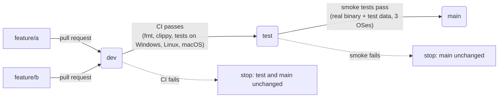

# Branch flow: feature → dev → test → main

Every change travels the same road, and `main` only ever holds code that passed
every stage:



| Branch | Who writes to it | What runs there | Moves on to |
|--------|------------------|-----------------|-------------|
| `feature/<name>` | you, one feature per branch | CI on every push and on the pull request (`ci.yml`) | `dev`, by merging the pull request |
| `dev` | pull requests only | CI again, on the merged result (`pipeline.yml`, job `dev-ci`) | `test`, automatically |
| `test` | the pipeline only | end-to-end smoke tests with test data (`pipeline.yml`, job `smoke`) | `main`, automatically |
| `main` | the pipeline only | — (release tags `v*` are cut from here, `release.yml`) | — |

Promotions are **fast-forward only** (`scripts/promote.sh`): `test` and `main` are
moved to the exact commit that was tested, never merged or rebased. If `main` or
`test` has a commit that `dev` does not (someone committed there directly), the
promotion stops with an error instead of overwriting it; merge that branch into
`dev` and the flow continues.

## Working on a feature

```bash
git switch -c feature/status origin/dev     # one branch per feature
# ... commits ...
git push -u origin feature/status
# open a pull request into dev; CI must be green before merging
```

After the merge nothing else is manual: the `Pipeline` workflow runs CI on `dev`,
fast-forwards `test`, runs the smoke tests, and fast-forwards `main`. Follow it
under **Actions → Pipeline**. A failure stops the flow at that stage; fix it with
a new pull request into `dev`.

## The test stage and its test data

`tests/smoke/run.sh` starts the release binary in front of a stand-in app and
checks what a visitor would see. The test data lives next to it:

| File | Role |
|------|------|
| `tests/smoke/smoke.toml` | hostip config: an open port 9443 and a password-protected port 9444 (`demo` / `secret`) in front of local port 3999, fixed public IP `203.0.113.7` (a documentation address), no router or Let's Encrypt access |
| `tests/smoke/app.py` | the stand-in app on port 3999, serving `data/` with `Range` support |
| `tests/smoke/data/hello.txt` | the file fetched through hostip |

Checks: the file arrives unchanged over HTTPS; a `Range` request comes back as
`206 Partial Content`; HTTP/2 is negotiated; port 9444 answers 401 without a
login, lets `demo:secret` through and refuses a wrong password; the certificate
names the public IP. Run it locally with

```bash
cargo build --release && tests/smoke/run.sh
```

## Demo with test data

`scripts/demo-flow.sh` plays the whole flow in a throwaway local repository, with
the same `promote.sh` the pipeline uses. A toy app is tested against rows of
test data in `cases.csv` (`operation,a,b,expected`): one feature passes and
reaches `main`; a second has a bug that the test data catches, so it stops at
`dev` until a fix arrives; finally a commit made directly on `main` shows the
fast-forward guard. Run it with `scripts/demo-flow.sh`; its output:

```text
== Start: main, test and dev at the same commit
   main  3e8a72e app: add
   test  3e8a72e app: add
   dev   3e8a72e app: add

== Feature 1 (good): feature/multiply adds an operation and its test data
-- pull request feature/multiply -> dev is reviewed and merged
   main  3e8a72e app: add
   test  3e8a72e app: add
   dev   3e70ac0 Merge feature/multiply
-- tests on dev (3e70ac0)
   pass  add 2 3 = 5
   pass  add -4 4 = 0
   pass  mul 6 7 = 42
   pass  mul -3 5 = -15
   promoted test: 3e8a72e -> 3e70ac0
-- tests on test (3e70ac0)
   pass  add 2 3 = 5
   pass  add -4 4 = 0
   pass  mul 6 7 = 42
   pass  mul -3 5 = -15
   promoted main: 3e8a72e -> 3e70ac0
   main  3e70ac0 Merge feature/multiply
   test  3e70ac0 Merge feature/multiply
   dev   3e70ac0 Merge feature/multiply

== Feature 2 (broken): feature/subtract has a bug the test data catches
-- merged into dev
-- tests on dev (e36cc4f)
   pass  add 2 3 = 5
   pass  add -4 4 = 0
   pass  mul 6 7 = 42
   pass  mul -3 5 = -15
   FAIL  sub 10 4: expected 6, got 14
   tests failed: test stays where it was
   main  3e70ac0 Merge feature/multiply
   test  3e70ac0 Merge feature/multiply
   dev   e36cc4f Merge feature/subtract
   main still has only tested code.

== Fix: a new commit on dev, and the flow continues
-- tests on dev (dc4a928)
   pass  add 2 3 = 5
   pass  add -4 4 = 0
   pass  mul 6 7 = 42
   pass  mul -3 5 = -15
   pass  sub 10 4 = 6
   promoted test: 3e70ac0 -> dc4a928
-- tests on test (dc4a928)
   pass  add 2 3 = 5
   pass  add -4 4 = 0
   pass  mul 6 7 = 42
   pass  mul -3 5 = -15
   pass  sub 10 4 = 6
   promoted main: 3e70ac0 -> dc4a928
   main  dc4a928 app: fix subtract
   test  dc4a928 app: fix subtract
   dev   dc4a928 app: fix subtract

== Guard: a commit made directly on main is never overwritten
   promoted test: dc4a928 -> 45f449a
   ::error::main has commits that 45f449a does not contain; merge main into dev first (never commit to test or main directly).
   refused: merge main into dev, then the flow continues
```

## One-time setup on GitHub

1. **Bring `dev` and `test` up to date with `main`.** The fast-forward rule needs
   `main` ⊆ `test` ⊆ `dev`. Merge `main` into `dev` (a pull request from `main` to
   `dev`); the next pipeline run then moves `test` and `main` forward.
2. **Protect the branches** (Settings → Rules → Rulesets):
   - `dev`: require a pull request and the `CI` checks to pass.
   - `test`, `main`: block direct pushes for everyone except the pipeline.
3. **Let the pipeline push.** With no protection on `test`/`main` the built-in
   token is enough. If they are protected, either add *GitHub Actions* to the
   ruleset's bypass list, or create a fine-grained token with *Contents: read
   and write* on this repository and save it as the secret `PROMOTE_TOKEN`
   (with that token, the push to `test` also starts its own run; the second
   promotion is then a harmless no-op).
4. **Default branch for pull requests:** set `dev` as the default branch so new
   pull requests target it.
